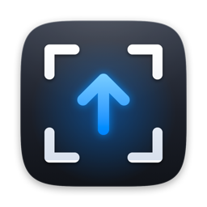
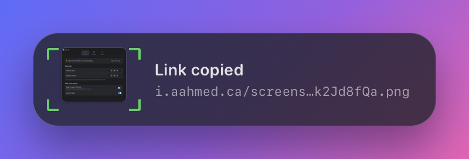
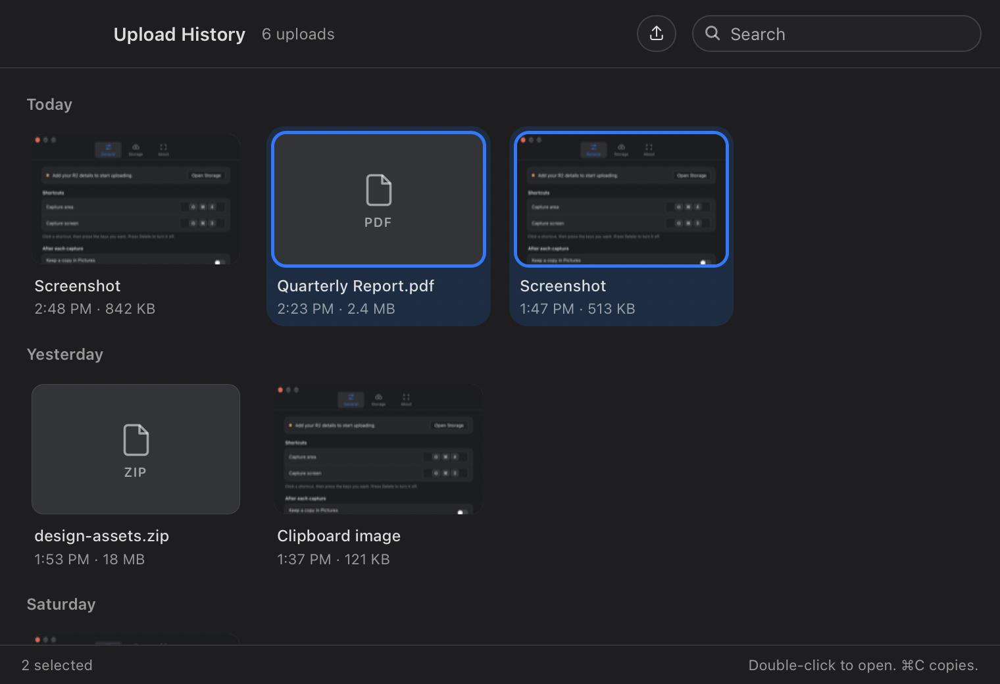
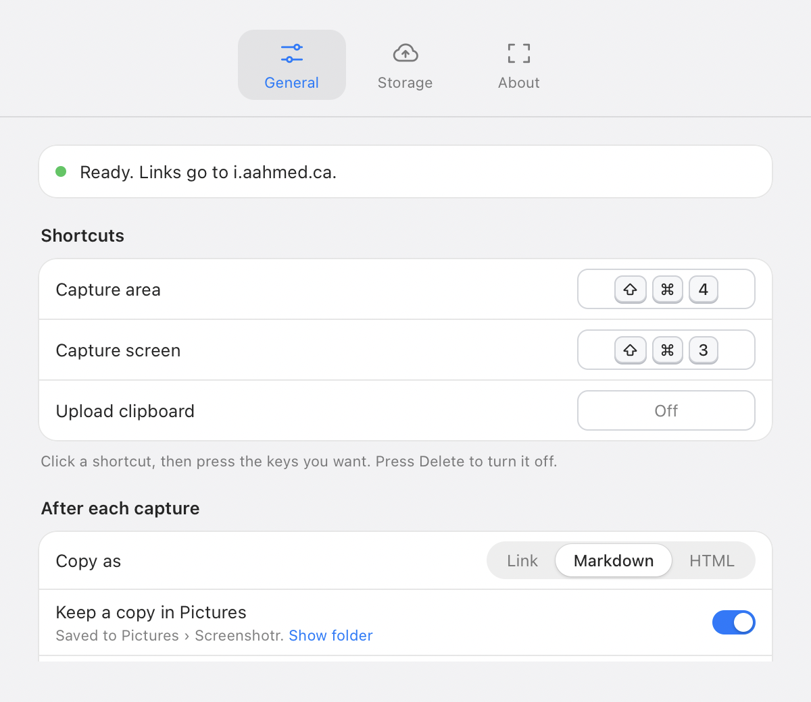
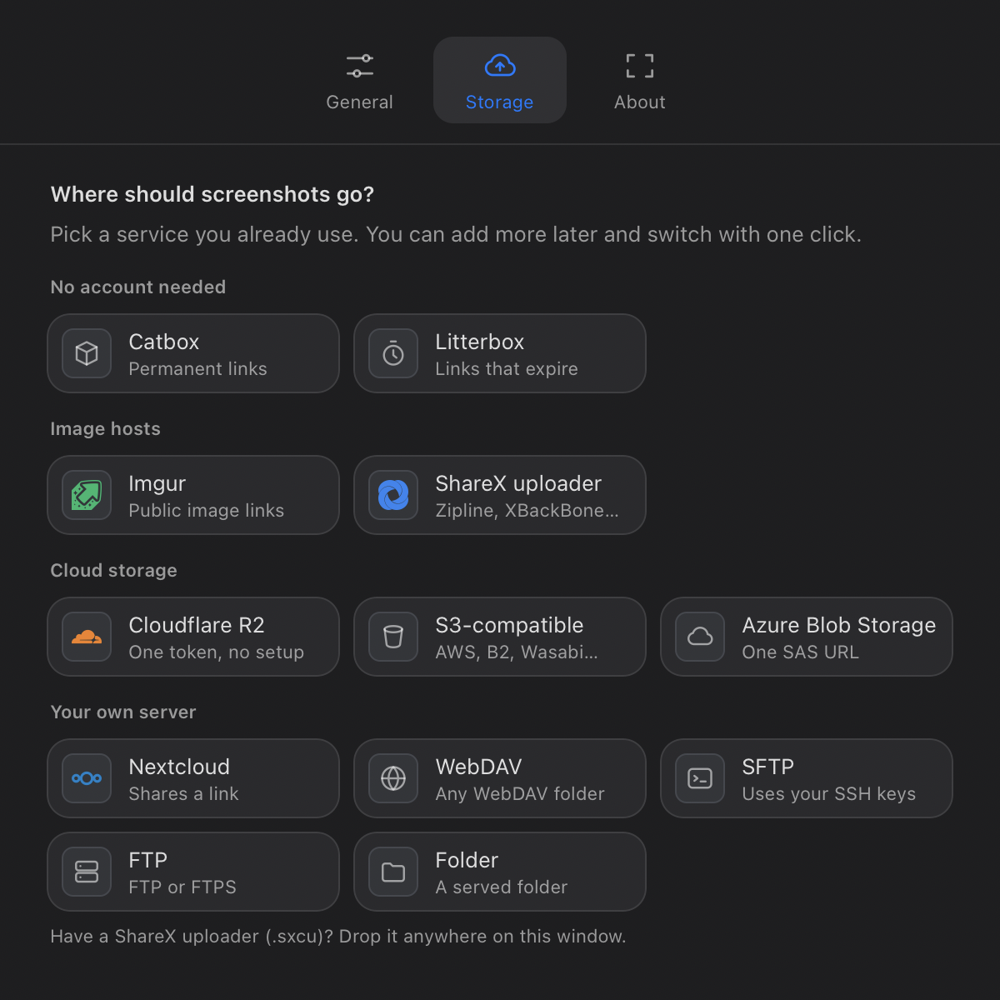

<p align="center">
  
</p>

<h1 align="center">Screenshotr</h1>

<p align="center">Press a shortcut, get a link.</p>

<p align="center">
  <a href="https://screenshotr.aahmed.ca"></a>
  
  
  
  
  <a href="LICENSE.md"></a>
</p>

<p align="center">
  
</p>

Screenshotr is a menu bar app for macOS ([screenshotr.aahmed.ca](https://screenshotr.aahmed.ca)). Take a screenshot with the usual shortcut and, a moment later, a link to it is on your clipboard. It uploads to storage you already have, whether that's an S3 bucket, a Nextcloud server, an SFTP folder, an image host or anything with a ShareX uploader, and it does the same for any file you drop on it.

It's built to feel like part of macOS: a Liquid Glass overlay, its own capture sound, Settings that follow your accent colour and dark mode, and a menu bar icon that shows what it's doing.

## Contents

- [What it does](#what-it-does)
- [Install](#install)
- [First run](#first-run)
- [Using Screenshotr](#using-screenshotr)
- [Destinations](#destinations)
- [Privacy](#privacy)
- [Building from source](#building-from-source)
- [Releasing](#releasing)
- [Project layout](#project-layout)
- [License](#license)

## What it does

**Capture and share.** ⇧⌘4 captures an area and ⇧⌘3 the whole screen, the same shortcuts as macOS. Screenshotr takes them over while it runs and hands them back when it quits. The overlay in the top-right corner shows the shot while it uploads, then confirms when the link is copied. Click it to open the link, or swipe it away.

**Upload anything.** Send any file from the menu bar, from Finder (Services › Upload with Screenshotr, or Open With), by dropping it on a Screenshotr window, or straight from the clipboard with an optional shortcut.

**Copy the link your way.** As a plain URL, a Markdown image or an HTML `` tag.

**Find it again later.** Upload History keeps your last 1,000 uploads with thumbnails, grouped by day and searchable. Copy or open one or many at once, or delete them from the server where the destination allows it.

**Bring your own storage.** Twelve kinds of destination, from "no account needed" to your own server. See [Destinations](#destinations).

**Stay current.** Signed updates install from inside the app, and Homebrew installs are supported.

<p align="center">
  
</p>

## Install

Screenshotr needs macOS 13 or later on Apple silicon.

Download the latest `.dmg` from [Releases](https://github.com/asharahmed/screenshotr/releases) and drag Screenshotr to Applications. Or, with Homebrew:

```sh
brew install --cask asharahmed/tap/screenshotr
```

The app is signed with a Developer ID and notarized by Apple, and it updates itself.

## First run

A short welcome window walks through three steps.

1. **Allow Screen Recording.** macOS asks once. Screenshotr only looks at the screen when you take a shot. macOS applies the permission after a restart, and the welcome window has a button for that.
2. **Choose where screenshots go.** Pick a destination in Settings › Storage.
3. **Take your first screenshot.** The step completes when the first link lands on your clipboard.

While it runs, Screenshotr turns off macOS's own ⇧⌘3 and ⇧⌘4 screenshot shortcuts so the two don't both fire. It turns them back on when it quits, even if it's stopped with Ctrl+C or `kill`. If it ever crashes, they're restored the next time it quits normally. You can also turn them on yourself in System Settings › Keyboard › Keyboard Shortcuts › Screenshots.

## Using Screenshotr

| Action | Default |
| --- | --- |
| Capture an area | ⇧⌘4 (Space switches to a window) |
| Capture the whole screen | ⇧⌘3 |
| Upload the clipboard | Off. Set one in Settings › General. |
| Open Upload History | ⌘Y from the menu bar menu |

The menu bar menu also has Upload Files…, Copy last link, Recent uploads, Settings and an update item when there's a new version. Change any shortcut in Settings › General by clicking it and pressing the new keys.

Each capture plays a short sound of its own (made by `src-tauri/sounds/make_capture_sound.py`). It follows the "Play user interface sound effects" setting in System Settings, and Settings › General can turn it off. After each capture you can keep a copy in Pictures › Screenshotr. If an upload fails, the capture is saved there anyway, so nothing is lost.

<p align="center">
  
</p>

## Destinations

Add as many as you like in Settings › Storage and switch between them with one click.

<p align="center">
  
</p>

| Destination | What you provide |
| --- | --- |
| Catbox | Nothing; links are permanent and public |
| Litterbox | Nothing; links expire after 1 hour to 3 days |
| Imgur | A client ID (images and videos only) |
| ShareX custom uploader | A `.sxcu` file. Drop it on the Settings window. Works with Zipline, XBackBone, Chevereto and others. |
| Cloudflare R2 | One API token. Screenshotr creates the bucket and turns on its public r2.dev address. |
| S3-compatible | Access keys and bucket, with presets for AWS, Backblaze B2, DigitalOcean Spaces, Wasabi and MinIO |
| Azure Blob Storage | A container SAS URL |
| Nextcloud | Server, user name and an app password; Screenshotr creates the share link |
| WebDAV | Folder URL and credentials |
| SFTP | Host and folder; uses your SSH keys, ssh-agent and `~/.ssh/config` |
| FTP / FTPS | Host, credentials and folder |
| Folder | A local folder a web server or sync app already publishes |

Every destination has a Test button. Deleting from the server works for S3-compatible destinations and Imgur. For ShareX uploaders, Screenshotr opens the deletion page the uploader provides.

## Privacy

- Screenshots and files go only to the destination you choose. Screenshotr has no server of its own and collects no analytics.
- Credentials are stored in your login Keychain, never in plain-text settings.
- Uploads to "no account needed" hosts are public. Use your own storage for anything sensitive.
- The only other network request is a once-a-day update check against this repository's releases, which you can turn off in Settings › About.

## Building from source

You need Rust and the Tauri 1 CLI:

```sh
cargo install tauri-cli --locked --version "^1.5"
```

Then, from the project directory:

| Command | What it does |
| --- | --- |
| `make dev` | Runs a development build with live reload of the web content |
| `make install` | Builds, signs with your Developer ID and installs to /Applications |
| `make release` | Builds a notarized release (see below) |
| `cargo test` (in `src-tauri`) | Runs the unit tests |

`make install` signs with the identity in `scripts/install-macos.sh`. Set `SIGNING_IDENTITY` to use your own. A stable signature matters because macOS ties the Screen Recording permission to it; with one, you grant permission once instead of after every build.

Development builds have a demo mode for working on motion without capturing or uploading anything: `SCREENSHOTR_DEMO=settings make dev` plays a tour of Settings, and `SCREENSHOTR_DEMO=hud` replays the capture overlay.

## Releasing

`make release` builds into `dist/v<version>/`:

- the app, signed with hardened runtime, then notarized and stapled
- a notarized disk image
- a signed update archive and `latest.json`, the feed the in-app updater reads
- the Homebrew cask with the new version and checksum

Run `scripts/release.sh --publish` to create the GitHub release and update the cask in the tap.

Before the first release, check `packaging/release.env` and save a notarization profile once:

```sh
xcrun notarytool store-credentials AC_PROFILE --apple-id <your Apple ID> --team-id <your team ID>
```

Updates are signed with a separate key, `~/.tauri/screenshotr.key`, made by `cargo tauri signer generate`. Back it up. Every future update must be signed with it, and a new key would leave existing installs unable to update.

## Project layout

| Path | Contents |
| --- | --- |
| `src-tauri/src/main.rs` | The app: capture, upload pipeline, menu bar, windows, history, updates |
| `src-tauri/src/destinations.rs` | Every destination's upload, test and delete, plus ShareX import |
| `src/settings.html` | Settings: General, Storage and About |
| `src/history.html` | The Upload History window |
| `src/hud.html` | The capture overlay |
| `src/welcome.html` | The first-run welcome window |
| `src/motion.js` | Spring animation shared by all windows |
| `src-tauri/icons/` | App and menu bar icons, with the Swift scripts that draw them |
| `src-tauri/sounds/` | The capture sound and the script that synthesizes it |
| `site/` | The website, published to GitHub Pages by `.github/workflows/pages.yml` |
| `scripts/`, `packaging/` | Install, release and Homebrew files |

Windows and Linux capture code exists from an earlier version but is untested, and the interface is designed for macOS.

## Acknowledgements

Service logos in Settings come from [Simple Icons](https://simpleicons.org) (CC0). The ShareX custom uploader format comes from [ShareX](https://getsharex.com).

## License

Screenshotr is source-available under the [PolyForm Noncommercial License 1.0.0](LICENSE.md). You may read, run and modify it for any noncommercial purpose: personal use, study, research, hobby projects, and use by charities, schools and public institutions. Commercial use of any kind, including selling it, offering it as a service, or using any part of the code in a commercial product, is not permitted.

For commercial licensing, contact Ashar Ahmed.
